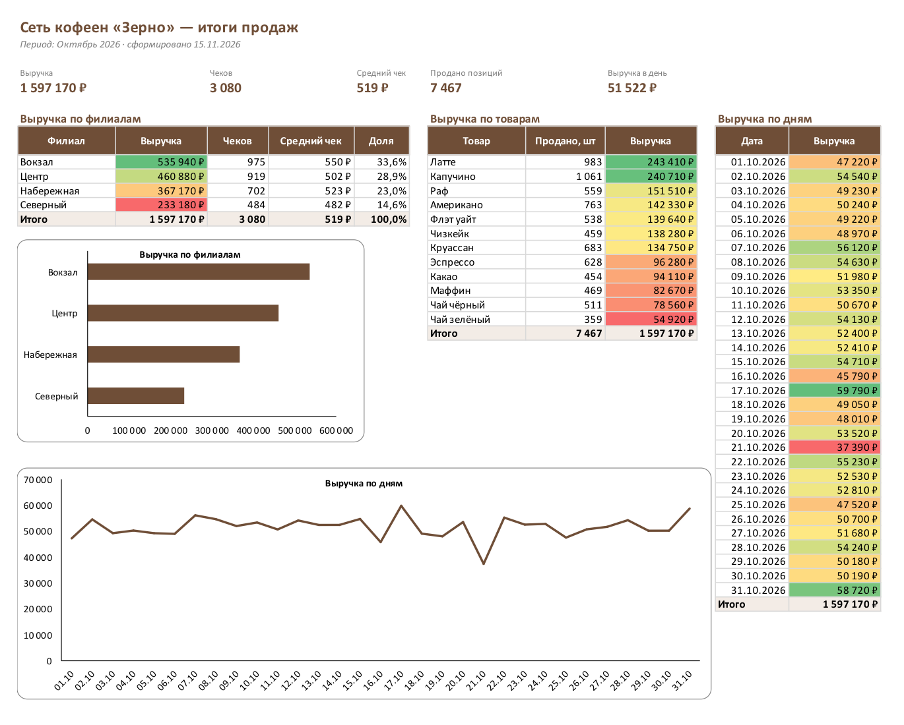

# Автоматизация отчётов о продажах: из «грязных» Excel в готовый отчёт

Демо-проект для портфолио. У вымышленной сети кофеен «Зерно» 4 филиала, и каждый
присылает Excel с продажами за месяц, причём по-своему. Скрипт собирает все файлы,
чистит данные и за пару секунд выдаёт оформленный `report.xlsx`, который можно сразу
отправлять руководителю. При желании отчёт и короткая сводка уходят в Telegram.



## Какие проблемы решает

Файлы филиалов «грязные», как в жизни:

| Проблема | Пример | Что делает скрипт |
|---|---|---|
| Разный порядок и названия колонок | `Товар` / `Наименование` / `product` / `ТОВАР` | приводит к единой схеме по словарю синонимов |
| Заголовки над таблицей | «Выгрузка из кассы», «Филиал: Центр» | сам находит строку с шапкой таблицы |
| Лишние пустые строки и строка «ИТОГО» | | удаляет |
| Даты в разных форматах | `2026-10-05`, `05.10.2026`, `5/10/26`, `2026/10/05`, `05.10.26`, серийный номер Excel `46300` | распознаёт всё (день/месяц — по-российски) |
| Числа текстом | `1 250,00`, `240 ₽` | переводит в числа |
| Опечатки и разный регистр | `Капуччино`, `КАПУЧИНО `, `Латтте`, `LATTE`, `чай черный` | сверяет со справочником товаров (нечёткое сравнение + синонимы) |
| Пропущенные суммы | пустая ячейка «Сумма» | считает как кол-во × цена |
| Дубли строк | повторная выгрузка чека | удаляет |
| Строки за соседний месяц | 30.09 и 01.11 в октябрьском файле | отбрасывает |
| Лишние колонки | `comment` | пропускает |

Обо всём исправленном скрипт пишет в консоль, так что заказчик видит, что именно
было не так в исходных данных.

## Что внутри отчёта

`report.xlsx` содержит три листа:

- **Итоги**: KPI (выручка, чеки, средний чек, позиции, выручка в день), выручка по
  филиалам, по товарам и по дням с цветовой шкалой; нативные графики Excel: столбчатая
  диаграмма по филиалам и линейный график выручки по дням.
- **Топ-10 товаров**: место, продажи в штуках, выручка, доля, средняя цена, гистограммы
  в ячейках.
- **Данные**: все очищенные строки с автофильтром и закреплённой шапкой.

Денежные форматы, ширина колонок и печать на A4 (альбомная ориентация, «Итоги» на одной
странице) уже настроены. Готовый пример лежит в
[`docs/report_example.xlsx`](docs/report_example.xlsx).

## Быстрый старт

```bash
python -m venv .venv
source .venv/bin/activate          # Windows: .venv\Scripts\activate
pip install -r requirements.txt

python generate_sample_data.py     # 4 тестовых файла в input/ (уже лежат в репозитории)
python report.py                   # → output/report.xlsx
```

## Примеры запуска

```bash
# по умолчанию: input/ → output/report.xlsx, месяц определяется по данным
python report.py

# явно указать папку, файл и месяц
python report.py --input input --output output/report_2026-10.xlsx --month 2026-10

# отчёт + сводка и файл в Telegram
python report.py --telegram

# сгенерировать тестовые данные за другой месяц
python generate_sample_data.py --month 2026-11 --output input_nov
python report.py --input input_nov --output output/report_2026-11.xlsx
```

| Аргумент | По умолчанию | Описание |
|---|---|---|
| `--input` | `input` | папка с файлами филиалов `.xlsx` (имя файла = название филиала) |
| `--output` | `output/report.xlsx` | куда сохранить отчёт |
| `--month` | самый частый месяц в данных | месяц отчёта `ГГГГ-ММ`; строки за другие месяцы отбрасываются |
| `--telegram` | выключено | отправить сводку и файл через Telegram-бота |

Пример вывода в консоль:

```
Очистка данных:

  Вокзал.xlsx: прочитано 1866 строк, после очистки 1807
    • служебных строк над таблицей: 4
    • пустых строк: 38
    • строк «Итого»: 1
    • дат в текстовом/числовом формате: 1827
    • чисел, записанных текстом: 1793
    • исправленных названий товаров: 620
    • дублей удалено: 20
      например: «LATTE» → Латте; «Капуччино» → Капучино; «чай черный» → Чай чёрный; «Круасан» → Круассан

  Набережная.xlsx: прочитано 1379 строк, после очистки 1336
    • пустых строк: 28
    • дат в текстовом/числовом формате: 271
    • восстановленных сумм (кол-во × цена): 67
    • исправленных названий товаров: 452
    • дублей удалено: 15
    • пропущены лишние колонки: comment
  ...

  Строк за пределами месяца 2026-10 отброшено: 25
  Итого: 5995 строк прочитано → 5772 чистых строк продаж

Отчёт за октябрь 2026 сохранён: output/report.xlsx
Выручка: 1 597 170 ₽, чеков: 3080
```

## Отправка в Telegram

1. Создайте бота у [@BotFather](https://t.me/BotFather) и получите токен.
2. Напишите боту любое сообщение (или добавьте его в рабочий чат) и узнайте `chat_id`,
   например через [@userinfobot](https://t.me/userinfobot).
3. Скопируйте `.env.example` в `.env` и заполните:
   ```
   TELEGRAM_BOT_TOKEN=123456:ABC...
   TELEGRAM_CHAT_ID=123456789
   ```
4. `python report.py --telegram`

В чат придёт сводка и сам файл отчёта:

```
☕ Отчёт о продажах — Октябрь 2026

Выручка: 1 597 170 ₽
Чеков: 3 080
Средний чек: 519 ₽

По филиалам:
• Вокзал: 535 940 ₽ (34%)
• Центр: 460 880 ₽ (29%)
• Набережная: 367 170 ₽ (23%)
• Северный: 233 180 ₽ (15%)

Лидер: Вокзал. Хит продаж: Латте.
```

Если отправить не удалось, отчёт всё равно сохраняется, а скрипт завершается с кодом 2.
Токен в сообщения об ошибках не попадает.

## Тесты

```bash
pytest
```

60 тестов на функции очистки: распознавание заголовков, форматы дат, числа, исправление
названий, удаление пустых, итоговых и дублирующихся строк, восстановление сумм, фильтр
по месяцу и сквозная проверка на небольшом «грязном» файле.

## Структура

```
├── generate_sample_data.py   # генератор 4 «грязных» файлов филиалов
├── report.py                 # CLI: очистка → отчёт → (Telegram)
├── coffee_report/
│   ├── cleaning.py           # чтение и очистка, учёт исправлений
│   ├── excel_report.py       # агрегаты и оформление report.xlsx (openpyxl)
│   └── telegram.py           # сводка и отправка через Bot API
├── tests/test_cleaning.py
├── input/                    # пример исходных файлов
└── docs/                     # скриншот и пример готового отчёта
```

## Как адаптировать под свои данные

- новые названия колонок добавляются в `HEADER_SYNONYMS` (`coffee_report/cleaning.py`);
- справочник товаров задают `CANONICAL_PRODUCTS` и `PRODUCT_ALIASES`;
- новые форматы дат добавляются в `DATE_FORMATS`;
- название компании и фирменный цвет отчёта задаются константами `COMPANY` и `BRAND`
  в `coffee_report/excel_report.py`.

Стек: Python 3.10+, pandas, openpyxl, requests, python-dotenv, pytest.
